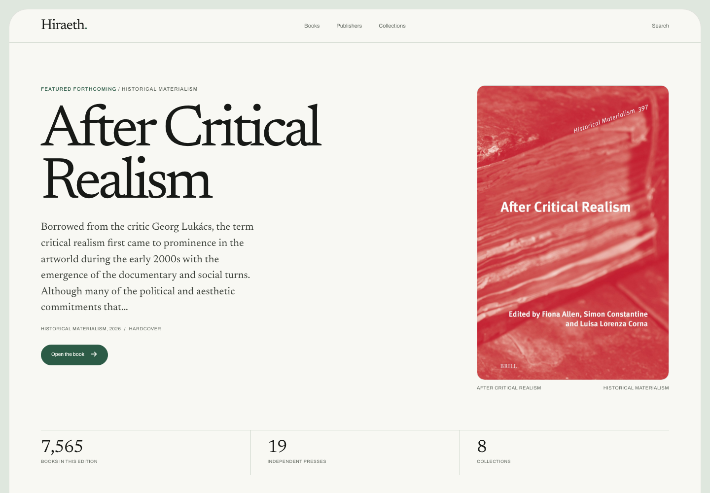
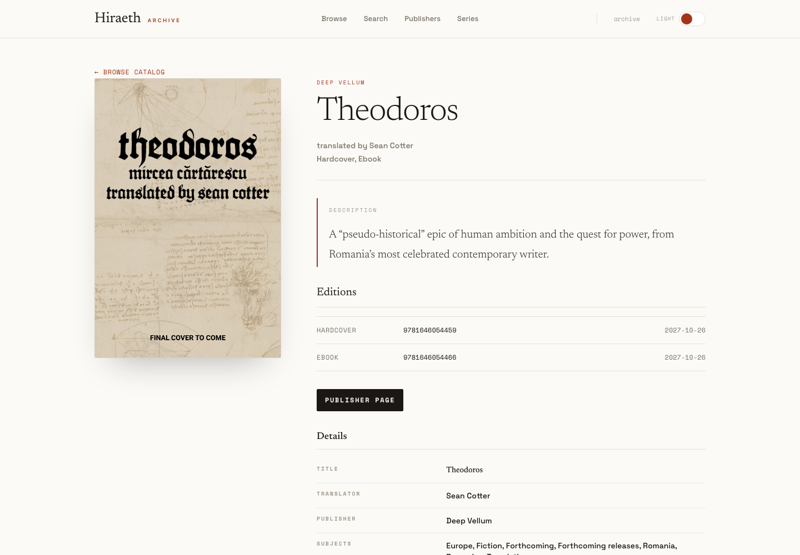
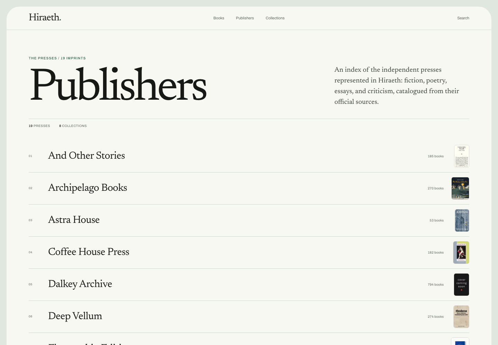
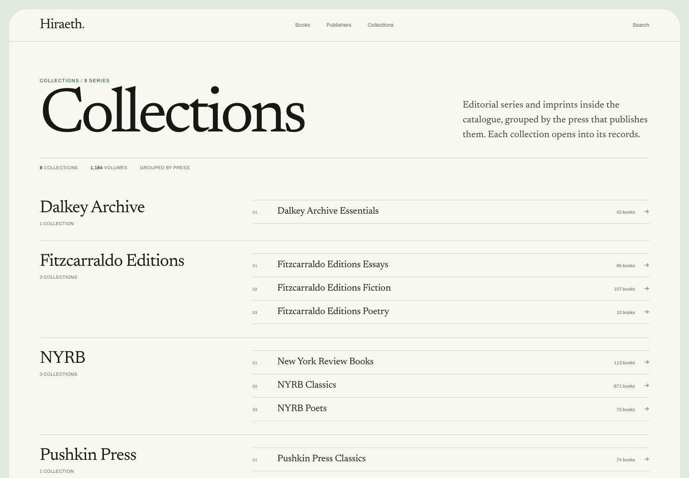
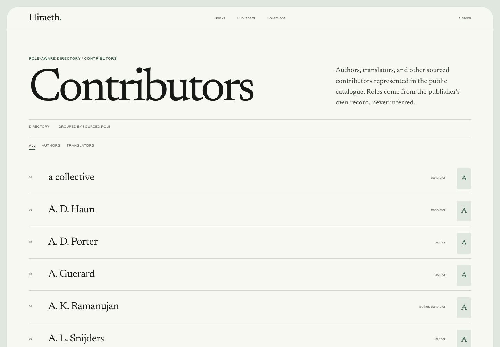

# Hiraeth

Hiraeth is a Phoenix LiveView and Ash catalog for browsing curated independent publisher books with provenance-aware imports, source provenance, local cover caching, and an autonomous ingestion pipeline.

It is browser-first: the primary surface is the LiveView catalog. It also serves a versioned, read-only JSON API at `/api/v1` from the same typed projections. Public routes include `/browse`, `/search`, `/publishers`, `/series`, `/contributors`, contributor role filters such as `/contributors?role=translator`, and book detail pages.

## Live deployment

The running catalog is deployed on Railway at
<https://web-production-a31e0.up.railway.app>. The Phoenix service, the private
FastAPI sidecar, PostgreSQL, and the R2 cover bucket are all provisioned.

[](https://web-production-a31e0.up.railway.app)

| Browse the catalog | Book detail |
| --- | --- |
| [](https://web-production-a31e0.up.railway.app/browse) | [](https://web-production-a31e0.up.railway.app/books/deep-vellum-carcasse) |

| Publishers | Press dossier |
| --- | --- |
| [](https://web-production-a31e0.up.railway.app/publishers) | [](https://web-production-a31e0.up.railway.app/publishers/coffee-house-press) |

| Collections | Collection shelf |
| --- | --- |
| [](https://web-production-a31e0.up.railway.app/series) | [](https://web-production-a31e0.up.railway.app/series/dalkey-archive-essentials) |

| Contributors | Search |
| --- | --- |
| [](https://web-production-a31e0.up.railway.app/contributors) | [](https://web-production-a31e0.up.railway.app/search?q=the) |

## What is in the app

- Curated catalog for the approved indie publisher corpus, currently 9,415 deterministic source records across providers such as New Directions, Deep Vellum, Pushkin Press, and more. Fum d'Estampa, Phoneme Media, La Reunion, and A Strange Object are catalogued as Deep Vellum imprints while retaining their original provider provenance.
- Provenance-aware imports, cover attribution, source artifact reports, and gap states instead of fabricated metadata.
- R2-backed public cover display served same-origin from `/covers/cache/...`; cards and book heroes use generated thumbnails, and unsafe or missing covers render typographic fallbacks.
- Ash-backed ingestion control plane for provider sources, provider runs, source snapshots, record candidates, diffs, quarantine, replay, and ingestion events.
- Oban-backed autonomous ingestion phases: plan, fetch, normalize, validate, diff, cover-cache, apply, audit, quarantine, replay, and retention cleanup.
- Private-by-default Python sidecar with strict CORS, typed errors, contract snapshots, and URL validation for fetch/scrape adapters.
- Typed public boundary: projection structs with `@type`/`@spec`, a spec-coverage contract test, Dialyzer in `mix ci`, and an OpenAPI 3.0 document generated from the controller operations.
- Versioned read-only JSON API at `/api/v1` for books, editions, publishers, series, and contributors; every response is validated against the served schema in tests.
- Documentation under `docs/`: API reference, typed boundary design, scalability and operations research, cover sourcing, and the repository audit.

## Catalog API

The API is read-only and versioned. The browser and the API serialize the same
`Hiraeth.Catalog.PublicProjection` structs, so a page and a response describe
the same record.

```sh
curl -s 'http://localhost:4000/api/v1/books?q=deep%20vellum&page_size=2'
curl -s 'http://localhost:4000/api/v1/publishers/deep-vellum'
curl -s 'http://localhost:4000/api/v1/openapi.json'
```

Reference: `docs/api/v1.md`. Schema: `GET /api/v1/openapi.json`.

## Run locally

Local dev runs the nix-profile toolchain directly on PATH (mix, Elixir/OTP, Node, Python/`uv`) plus a standalone PostgreSQL 16 on `127.0.0.1:54320` managed by `scripts/dev/ensure_postgres.sh`. Install the postgres binaries once with `nix profile add nixpkgs#postgresql_16`; the script `die`s with this exact instruction when they are missing from PATH, and nothing is installed into your nix profile automatically. Docker remains the production runtime boundary reference: Railway builds the Phoenix service from the root `Dockerfile` and the sidecar from `sidecar/Dockerfile`, not a local setup path.

The devenv config files (`devenv.nix`, `devenv.yaml`, `flake.nix`, `devenv.lock`, `flake.lock`, `.envrc`) stay in the repo as dormant groundwork for a later revival; local development does not invoke devenv or nix. Reviving that path later means a `devenv shell` for ad hoc Mix commands and the devenv process runner for managed local PostgreSQL, Phoenix, and sidecar processes.

Start and stop the standalone postgres. The first `start` initializes `tmp/pgdata` and bootstraps the `hiraeth_dev`/`hiraeth_test` databases plus the `postgres` role (superuser, password `postgres`):

```sh
bash scripts/dev/ensure_postgres.sh start
bash scripts/dev/ensure_postgres.sh status
bash scripts/dev/ensure_postgres.sh stop
```

Then run the app:

```sh
mix deps.get
mix ash.migrate
MIX_ENV=test mix ash.migrate
mix run priv/repo/seeds.exs
mix phx.server
```

Open <http://localhost:4000>. Postgres data lives in the gitignored `tmp/pgdata` inside the checkout, so a checkout on an external volume keeps database writes off the system disk (`HIRAETH_PGDATA` overrides it). Logs go to `tmp/postgres.log` (`HIRAETH_PGLOG`); readiness is probed with `pg_isready -h localhost -p 54320 -U postgres`.

## Operate ingestion

```sh
mix hiraeth.providers.backfill
mix hiraeth.ingest --provider deep_vellum_official_store --dry-run --json
mix hiraeth.ingest --provider deep_vellum_official_store --wait
mix hiraeth.catalog.refresh --all --dry-run --json
mix hiraeth.catalog.refresh --provider astra_house_official_store --apply --json
mix hiraeth.covers.sync --all --missing --json
mix hiraeth.covers.audit --json
mix hiraeth.cache_covers
mix hiraeth.real_catalog.sync --check
mix hiraeth.audit_provenance --seed
mix hiraeth.real_catalog.source_artifacts
mix hiraeth.real_catalog.coverage_report
```

`mix hiraeth.covers.sync` fills missing originals and thumbnails from the
recorded official cover URLs. `mix hiraeth.catalog.refresh` fetches current
records from the per-provider script or sidecar profile, merges them additively,
regenerates the source-authority/artifact/coverage evidence, imports them, and
caches covers. See [docs/covers.md](docs/covers.md) for the full pipeline.

Autonomous scheduled ingestion runs on its own per-provider cadence; see the "Autonomous catalog updates" runbook section for what runs when, the `HIRAETH_SCHEDULED_INGEST` kill-switch (off by default locally via devenv), and rollout order.

## Verify/build

Verification is local-only: there is no GitHub Actions CI (workflows removed August 2026, pinned by `test/hiraeth/dev_environment_ci_contract_test.exs`). The local surface is `mix gate` (≤5 min blocking gate), `mix test.fast`, `mix test.full`, `mix ci`, `mix dialyzer`, and `make verify`.

- **Layer 0: local blocking gate (`mix gate`, ≤5 min):** `make gate` wraps the `mix gate` alias (compile with warnings-as-errors, unused-deps check, format check, strict Credo, and the fast ExUnit lane). It is the single blocking local preflight for every change.

Frontend correctness is verified by the LiveView and route logic test suites under `test/hiraeth_web/live/` (and the route/controller tests under `test/hiraeth_web/`), which run as part of the ExUnit lanes above; there is no separate browser-level QA lane.

Fast local preflight targets the under-60s developer loop:

```sh
mix gate             # single fast blocking gate
mix test.fast        # fast ExUnit lane, excluding explicit cost tags
```

Full local, CI, and release assurance stays separate and should not be expected to fit the fast-loop budget:

```sh
mix test.full        # complete ExUnit suite
mix ci               # full Phoenix CI/release assurance
HIRAETH_ALLOW_DEV_DB_RESET=1 make verify   # provenance audit, verify summary, QA pack
```

`make verify` is destructive by design: its provenance step drops and reseeds the
development database. It refuses to run without `HIRAETH_ALLOW_DEV_DB_RESET=1`
and refuses any `DATABASE_URL` that does not point at localhost. The seeded audit
also fails when it finds zero source records, so an empty database cannot produce
an all-clear report.

Adjacent release/full-verification lanes remain outside the fast gate:

```sh
cd sidecar && uv run --extra dev pytest -q
bash scripts/qa/ingestion/production_ingestion_drill.sh
bash scripts/qa/ingestion/production_ingestion_adversarial.sh
```

Stable operator entrypoints stay at the root or top-level task names (`make verify`, Mix tasks). Implementation helpers are grouped by purpose: catalog maintenance scripts live in `scripts/catalog/`, and production-ingestion drills in `scripts/qa/ingestion/`.

## Cleanup safety

Repository cleanup is allowlist-only and must never delete, clean, modify, or
regenerate the root `priv/static/covers/cache/*` cover cache. Run cache-writing
verification through `scripts/qa/cover_cache_sandbox.sh` so the root cover cache
is hashed before and after the sandboxed command.

## Production notes

The repository includes environment examples in `.env.example`; there is no GitHub Actions CI. The public catalog is deployed to Railway at `https://web-production-a31e0.up.railway.app`.

The Railway project has three services. `web` builds from the root `Dockerfile`, serves the LiveView catalog and `/api/v1`, and healthchecks `/health`. `sidecar` builds from `sidecar/Dockerfile`, stays on private networking, and healthchecks `/health/`. `Postgres` is Railway-managed. `railway.json` and `sidecar/railway.json` pin the healthcheck and restart policy. The web service sets `PHX_HOST` to the generated domain, `DATABASE_URL=${{Postgres.DATABASE_URL}}`, `SCRAPLING_SIDECAR_URL=http://sidecar.railway.internal:8000`, `HIRAETH_READY_SIDECAR_REQUIRED=1`, and `HIRAETH_SCHEDULED_INGEST=false` for the public demo.

The release image has no Mix, so migrations and seeding run from a checkout against the Railway database through a temporary TCP proxy. Create the proxy, point `DATABASE_URL` at its endpoint, run the commands, then delete the proxy:

```sh
railway tcp-proxy create --port 5432 --service Postgres
MIX_ENV=dev DATABASE_URL=postgresql://... mix ash.migrate
MIX_ENV=dev DATABASE_URL=postgresql://... mix run priv/repo/seeds.exs
railway tcp-proxy delete <proxy-id> --yes
```

The seed loads 9,415 source records. Re-run `node scripts/qa/live_screenshots.mjs https://web-production-a31e0.up.railway.app` to refresh the README images and `docs/screenshots/routes.json` after a visible change. The script captures the home, browse, book, publishers, press, collections, collection, contributors, and search surfaces at 1440×1000.

Covers use Cloudflare R2 as the durable store when `HIRAETH_COVER_STORE=s3`. Set `R2_ENDPOINT`, `R2_BUCKET`, `R2_ACCESS_KEY_ID`, `R2_SECRET_ACCESS_KEY`, and optionally `R2_REGION` (default `auto`). The Phoenix service keeps a bounded local cache and proxies `/covers/cache/...` misses from R2, so public URLs, the CSP, and takedown behavior stay unchanged. Run `mix hiraeth.covers.upload` once after switching an existing disk cache to R2, or to rebuild a bucket. Leave `HIRAETH_COVER_STORE=local` to run disk-only. Thumbnails require ImageMagick; the Docker runtime installs it, and local bare-toolchain users can run `nix profile add nixpkgs#imagemagick`. The five publisher pages that previously had no covers (Astra House, Pushkin Press, Seven Stories Press, Tilted Axis Press, Wakefield Press) are covered by `mix hiraeth.covers.sync`; see [docs/covers.md](docs/covers.md).

Both services must share `SCRAPLING_SIDECAR_TOKEN`. The sidecar image runs in secure mode, refuses to start without the token and its manifests, and rejects unsigned data requests. Phoenix refuses to boot in production without the token and signs every sidecar request. When a provider manifest changes, run `bash scripts/catalog/sync_sidecar_manifests.sh` before building the sidecar; a sidecar test fails if the image copies drift from `priv/catalog_sources/provider_manifests`.

Validate deployment networking, secrets, backups, and alerts in the target environment before any further launch.
